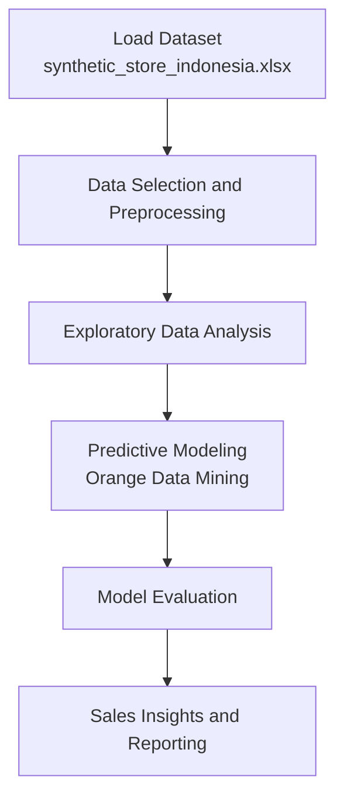

# Analisis Prediktif dan Informasi Penjualan Supermarket

## Author

| Name | Role |
|---|---|
| Yanaka Sofia Pardede | Data Analysis & Predictive Modeling |

## Project Overview

Optimalisasi operasional bisnis ritel dan supermarket membutuhkan pemahaman yang baik terhadap pola transaksi, perilaku penjualan, serta faktor-faktor yang memengaruhi kinerja bisnis. Analisis data penjualan dapat membantu mengidentifikasi informasi penting yang mendukung proses evaluasi dan pengambilan keputusan bisnis.

Proyek ini berfokus pada analisis informasi dan pemodelan prediktif penjualan supermarket di Indonesia menggunakan **Orange Data Mining**. Dataset utama yang digunakan adalah `synthetic_store_indonesia.xlsx`, yang berisi data penjualan supermarket sintetis, serta dokumen pendukung `informasi_penjualan_super_market_indonesia.pdf`.

Melalui pendekatan *visual data mining*, proyek ini mencakup tahapan pengolahan data, eksplorasi pola penjualan, pemodelan prediktif, dan evaluasi hasil menggunakan workflow Orange Data Mining.

## Objectives

Tujuan dari proyek ini adalah:

1. Melakukan eksplorasi dan persiapan data penjualan supermarket berdasarkan dataset yang tersedia.
2. Membangun workflow analisis dan pemodelan prediktif menggunakan Orange Data Mining.
3. Mengidentifikasi pola serta informasi penting yang berkaitan dengan kinerja penjualan supermarket.
4. Mengevaluasi hasil pemodelan berdasarkan proses analisis yang diterapkan.
5. Mendokumentasikan hasil analisis dalam bentuk laporan dan referensi pendukung.

## Dataset and Project Artifacts

Proyek ini menggunakan beberapa berkas utama sebagai berikut:

| File | Description |
|---|---|
| `synthetic_store_indonesia.xlsx` | Dataset sintetis penjualan supermarket di Indonesia. |
| `analisis-prediktif-supermarket.ows` | Workflow analisis dan pemodelan menggunakan Orange Data Mining. |
| `informasi_penjualan_super_market_indonesia.pdf` | Dokumen ringkasan informasi dan hasil analisis penjualan supermarket. |
| `url.txt` | Berkas yang berisi tautan referensi atau sumber pendukung proyek. |

**Dataset Note:** Dataset yang digunakan merupakan data sintetis sehingga pola dan hasil analisis yang diperoleh merepresentasikan data simulasi, bukan keseluruhan kondisi transaksi supermarket aktual di Indonesia.

## Workflow

Proses analisis dan pemodelan prediktif dilakukan melalui beberapa tahapan utama:



### Workflow Description

1. **Data Loading:** Memuat dataset penjualan supermarket ke dalam Orange Data Mining.
2. **Data Preprocessing:** Melakukan seleksi dan persiapan data sebelum analisis.
3. **Exploratory Data Analysis:** Mengeksplorasi karakteristik data dan pola penjualan.
4. **Predictive Modeling:** Membangun model prediktif menggunakan workflow Orange Data Mining.
5. **Model Evaluation:** Mengevaluasi hasil pemodelan berdasarkan konfigurasi evaluasi yang diterapkan.
6. **Sales Insights and Reporting:** Menyusun informasi dan temuan analisis ke dalam dokumentasi hasil.

## Modeling and Analysis Scope

| Component | Description |
|---|---|
| Platform | Orange Data Mining |
| Dataset | `synthetic_store_indonesia.xlsx` |
| Analysis Approach | Visual Data Mining |
| Analysis Focus | Pola penjualan supermarket dan pemodelan prediktif |
| Workflow Format | Orange Workflow (`.ows`) |
| Report Format | PDF |
| Supporting References | `url.txt` |

## Key Highlights

- Penggunaan Orange Data Mining untuk membangun workflow analisis dan pemodelan prediktif secara visual.
- Pemanfaatan dataset sintetis sebagai dasar eksplorasi dan analisis penjualan supermarket.
- Penerapan tahapan pengolahan data, eksplorasi, pemodelan, dan evaluasi dalam satu workflow.
- Dokumentasi informasi penjualan supermarket dalam bentuk laporan PDF.
- Penyediaan referensi pendukung untuk melengkapi dokumentasi proyek.

## Limitations and Future Work

### Limitations

- **Synthetic Dataset:** Dataset yang digunakan bersifat sintetis sehingga hasil analisis belum tentu merepresentasikan kondisi operasional supermarket secara nyata.
- **Model Evaluation:** Interpretasi performa model bergantung pada target prediksi, algoritma, dan metrik evaluasi yang diterapkan dalam workflow.
- **Data Generalization:** Hasil pemodelan memerlukan pengujian lebih lanjut menggunakan data transaksi aktual untuk mengetahui kemampuan generalisasi model.

### Future Work

Beberapa pengembangan yang dapat dilakukan pada proyek selanjutnya meliputi:

- Menggunakan dataset transaksi supermarket aktual untuk meningkatkan relevansi analisis.
- Melakukan perbandingan beberapa algoritma prediktif.
- Menerapkan *feature engineering* untuk meningkatkan kualitas data.
- Mengoptimalkan parameter model berdasarkan hasil evaluasi.
- Mengembangkan visualisasi dan dashboard interaktif untuk mendukung pemantauan kinerja penjualan.

## Tools and Technologies

| Tools / Technologies | Usage |
|---|---|
| Orange Data Mining | Data analysis, visual data mining, and predictive modeling |
| Microsoft Excel | Dataset storage and management |
| Markdown | Project documentation |
| PDF | Analysis report documentation |

## How to Run

Untuk menjalankan proyek ini, ikuti langkah-langkah berikut:

1. Pastikan Orange Data Mining telah terpasang pada perangkat.
2. Clone repository ini atau unduh seluruh berkas proyek.
3. Buka Orange Data Mining.
4. Buka file `analisis-prediktif-supermarket.ows` melalui Orange Data Mining.
5. Periksa kembali konfigurasi *file path* pada widget pembaca data agar mengarah ke `synthetic_store_indonesia.xlsx`.
6. Jalankan workflow untuk meninjau tahapan analisis, visualisasi, dan evaluasi model.
7. Buka `informasi_penjualan_super_market_indonesia.pdf` untuk membaca dokumentasi informasi penjualan.
8. Periksa `url.txt` untuk mengakses referensi atau tautan pendukung.

## Repository Structure

```text
supermarket-predictive-analysis/
│
├── analisis-prediktif-supermarket.ows
├── synthetic_store_indonesia.xlsx
├── informasi_penjualan_super_market_indonesia.pdf
├── url.txt
└── README.md
```

## Conclusion

Proyek ini mengimplementasikan pendekatan visual data mining menggunakan Orange Data Mining untuk melakukan analisis informasi dan pemodelan prediktif pada data penjualan supermarket sintetis di Indonesia.

Melalui workflow yang dibangun, proyek ini mengintegrasikan tahapan persiapan data, eksplorasi, pemodelan, dan evaluasi untuk memperoleh informasi yang dapat digunakan sebagai bahan pendukung analisis kinerja penjualan.

Hasil proyek ini diharapkan dapat menjadi salah satu penerapan analisis data dan predictive modeling dalam konteks bisnis ritel, sekaligus menjadi dasar pengembangan analisis yang lebih lanjut menggunakan data transaksi aktual.
